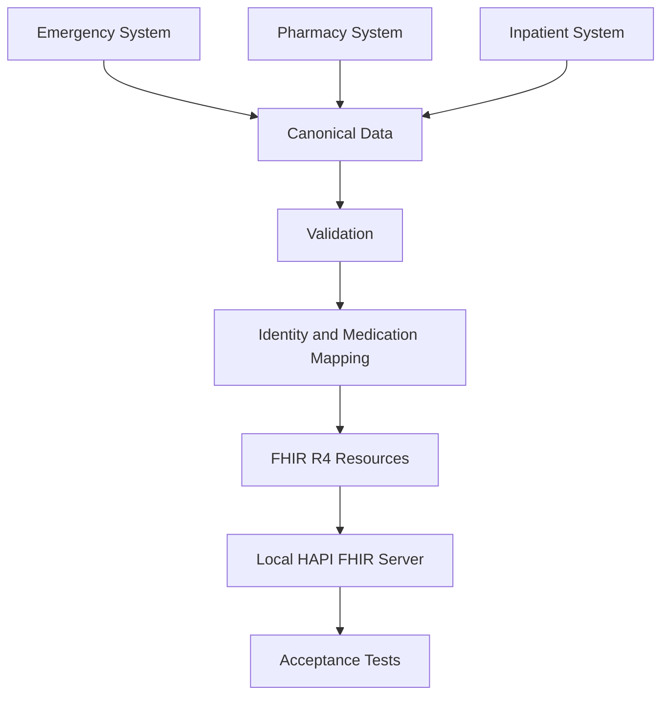

# Medication Interoperability with HL7 FHIR

## Project Overview

This project explores a clinical interoperability problem involving medication
information across Emergency Department, Pharmacy and Inpatient care.

The project was inspired by a real situation observed in hospital practice.
Emergency and Inpatient care may use different clinical platforms, and when
information is not shared effectively between them, medication administered in
one context may not be immediately visible in the next.

To explore this problem safely, the project uses only synthetic data and does
not reproduce the real architecture of any hospital system.

The main question is:

> Can medication administered in the Emergency Department be made available to
> the Inpatient workflow while keeping the original clinical context?

The project uses HL7 FHIR R4 as the common model for representing the clinical
information.

This is a proof of concept. It is not a real integration with SClínico, GLINTT
or any other hospital production system.

---

## Clinical Problem

When a patient is admitted after being seen in the Emergency Department, the
receiving team may need to know:

- which medication was already administered;
- the dose;
- the route;
- the administration time;
- who administered it;
- the clinical encounter where it happened.

The important point is that sharing this information should not change its
meaning.

For example, medication given in the Emergency Department should remain linked
to the Emergency encounter even after the patient has an active Inpatient
encounter.

---

## Synthetic Use Case

The project simulates three logical systems:

1. Emergency Clinical System
2. Pharmacy / Medication System
3. Inpatient Clinical System

The synthetic workflow is:

```text
Emergency Department
        |
        | prescription
        v
     Pharmacy
        |
        | dispensing
        v
Emergency Department
        |
        | administration
        v
    Admission
        |
        v
Inpatient Unit
```

The patient receives Paracetamol in the Emergency Department and is later
admitted to an Inpatient unit.

The prototype then tests whether that previous administration can still be
retrieved without being represented as if it had occurred during the Inpatient
encounter.

---

## Scope

The project includes:

- synthetic patient, professional, encounter and medication data;
- prescription, dispensing and administration events;
- a common canonical data model;
- basic data validation rules;
- patient, practitioner and medication mapping;
- HL7 FHIR R4 resources;
- validation of the generated FHIR resources;
- local testing with a HAPI FHIR server;
- acceptance tests for the main clinical scenario.

The project does not include:

- real patient or institutional data;
- direct connection to SClínico or GLINTT;
- real hospital APIs or interfaces;
- production authentication or security;
- a full Master Patient Index;
- production terminology services;
- medication reconciliation;
- clinical decision support;
- real-time production integration.

---

## Architecture

The project follows a simple flow:



The three simulated systems intentionally use different local identifiers and
medication codes.

The canonical layer gives the project one common representation before the
information is converted to FHIR.

---

## Canonical Data Model

The canonical model is a common representation of data coming from different
systems.

For example, the same synthetic patient has different local identifiers:

```text
Emergency   ER-P001
Pharmacy    PH-P874
Inpatient   IP-P144
                |
                v
              PAT001
```

The same idea is used for professionals:

```text
DOC023  -> PRAC001
NUR014  -> PRAC002
PHA006  -> PRAC003
DOC041  -> PRAC004
```

And for medication:

```text
Emergency   PARA-INF
Pharmacy    PAR10MGML
Inpatient   PCM-IV
                |
                v
              MED001
                |
                v
      Paracetamol 10 mg/mL
```

This makes it possible to separate the way each source system represents data
from the common representation used by the interoperability workflow.

The canonical data is stored in structured CSV files.

---

## Data Validation

Before creating FHIR resources, medication administration records are checked
with three basic rules.

### 1. Prescription exists

An administration must reference an existing prescription.

Expected validation error:

```text
MISSING_PRESCRIPTION
```

### 2. Medication code is known

The local medication code must exist in the medication mapping.

Expected validation error:

```text
UNKNOWN_MEDICATION_CODE
```

### 3. Administration occurs after prescription

The administration time cannot be earlier than the prescription time.

Expected validation error:

```text
ADMINISTRATION_BEFORE_PRESCRIPTION
```

The project contains valid synthetic data and a small invalid dataset created
specifically to test these rules.

These rules are intentionally simple. They are enough to test the main project
logic but are not a complete clinical validation system.

---

## Identity and Medication Mapping

Different systems may use different identifiers for the same real-world
concept.

In this prototype:

- local patient identifiers are linked to `PAT001`;
- local professional identifiers are linked to `PRAC001` to `PRAC004`;
- local medication codes are linked to `MED001`.

This step is important because interoperability is not only about moving data.
The receiving side also needs to understand who and what the data refers to.

A real hospital implementation would require stronger identity management and
validated clinical terminologies.

---

## FHIR Resources

The project uses the following HL7 FHIR R4 resources:

- `Patient`
- `Practitioner`
- `Encounter`
- `Medication`
- `MedicationRequest`
- `MedicationDispense`
- `MedicationAdministration`

The main clinical relationship is:

```text
Patient
  |
  +-- Encounter: Emergency
  |      |
  |      +-- MedicationRequest
  |      +-- MedicationDispense
  |      +-- MedicationAdministration
  |
  +-- Encounter: Inpatient
```

The Emergency and Inpatient encounters remain separate.

A medication administered in the Emergency Department remains linked to that
Emergency encounter.

---

## FHIR Validation and Local Server Testing

The generated resources were checked against **FHIR R4 4.0.1** using the HL7
FHIR Validator.

The final resource set had:

```text
0 structural FHIR errors
```

Some non-critical warnings remained, mainly related to human-readable narrative
and the synthetic medication code system. These were reviewed and accepted
within the scope of the prototype.

The resources were also loaded into a local **HAPI FHIR JPA Server**.

This allowed the project to check that the resources could be stored, searched
and linked in a FHIR environment.

One useful finding was the difference between:

```text
Functional identifier: PAT001
Technical FHIR reference: Patient/1000
```

The functional identifier represents the patient in the project, while the
technical reference points to a specific resource stored on the FHIR server.

The local HAPI server was used only for testing. It does not represent the
architecture of a real hospital system.

---

## Acceptance Tests

Five acceptance tests were used to check the main behaviour of the prototype.

| Test | What was checked | Result |
|---|---|---|
| AT-01 | Emergency medication remains available after admission | PASS |
| AT-02 | Different local patient IDs resolve to the same patient | PASS |
| AT-03 | Pharmacy dispense remains linked to the original prescription | PASS |
| AT-04 | Different local medication codes resolve to the same medication | PASS |
| AT-05 | Medication administration keeps the original Emergency context | PASS |

### Main acceptance test

The most important test was the transition from Emergency to Inpatient care.

The expected behaviour was:

```text
15:10
Medication administered in Emergency
        |
        v
16:05
Patient admitted to Inpatient care
        |
        v
Previous administration remains available
and still belongs to the Emergency encounter
```

This test passed in the synthetic prototype.

---

## Main Findings

The project led to a few main conclusions.

### Clinical context must be preserved

Information can be shared across clinical contexts without changing where the
event originally happened.

A medication administered in Emergency should not later appear as an Inpatient
administration.

### Interoperability is more than data transfer

Different systems may use different identifiers and codes.

Patient identity, professional identity and medication terminology need to be
understood before the data can be safely shared.

### A common model helps connect different systems

The canonical model provides a common representation before the data is mapped
to FHIR.

FHIR then provides a standard way to represent the clinical information.

### The prototype shows technical feasibility, not a real hospital integration

The project shows that a FHIR-based model can support continuity of medication
information between simulated Emergency and Inpatient workflows while
preserving the original clinical context.

It does **not** show that SClínico and GLINTT can be directly connected using
this implementation.

A real integration would also depend on:

- the interfaces available in each system;
- hospital integration architecture;
- patient identity management;
- medication terminology;
- authentication and permissions;
- audit and traceability;
- error handling;
- clinical safety;
- data protection and governance.

---

## Important Design Decisions

A few decisions were particularly important for the project.

### Keep the original encounter

Medication administration stays linked to the Emergency encounter where it
actually happened.

### Keep prescription, dispensing and administration separate

These are different clinical events and are represented separately using:

- `MedicationRequest`
- `MedicationDispense`
- `MedicationAdministration`

### Do not create a second prescription for the Pharmacy internal order

The Pharmacy order represents local processing of the original prescription.
It is not treated as a new clinical prescription.

### Use synthetic namespaces and data

All identifiers, codes and namespaces used by the project are synthetic and do
not represent real institutional systems.

### Keep the first version limited

The goal was to test one interoperability problem clearly rather than build a
complete medication platform.

---

## Limitations

This project has several important limitations:

- all data is synthetic;
- only one small clinical scenario is represented;
- patient identity resolution is simplified;
- medication terminology is simplified;
- only three validation rules are implemented;
- there is no production security or governance layer;
- there is no real-time integration infrastructure;
- the HAPI FHIR server is only a local test environment;
- no real hospital system was connected.

The project should therefore be read as a learning and proof-of-concept
exercise, not as a production-ready solution.

---

## AI-Assisted Development

A substantial part of the technical implementation was developed with AI
assistance.

AI was used especially for:

- Python code generation and organisation;
- loaders and validators;
- FHIR mapping code;
- troubleshooting;
- FHIR Validator setup;
- local HAPI FHIR server setup;
- REST testing;
- interpretation of technical errors and warnings;
- support in technical documentation.

My main contribution was focused on:

- identifying and explaining the clinical problem;
- defining and reviewing the workflow;
- deciding the project scope;
- defining the clinical meaning of the data;
- reviewing the canonical model;
- defining validation requirements;
- discussing FHIR mapping decisions;
- defining the acceptance criteria;
- running the prototype and reviewing the results against the intended clinical
  behaviour.

This project should therefore be understood as an **AI-assisted technical proof
of concept**, not as software independently developed from scratch.

---

## Repository Structure

```text
fhir-medication-interoperability/
|
├── .gitignore
├── README.md
├── requirements.txt
|
├── config/
|   └── fhir_systems.py
|
├── data/
|   ├── canonical/
|   |   ├── valid/
|   |   └── invalid/
|   |
|   ├── processed/
|   |   └── validation_report.csv
|   |
|   └── fhir/
|       ├── Patient/
|       ├── Practitioner/
|       ├── Medication/
|       ├── Encounter/
|       ├── MedicationRequest/
|       ├── MedicationDispense/
|       └── MedicationAdministration/
|
├── docs/
│   ├── acceptance_tests.md
│   └── technical_notes.md
|
├── notebooks/
|   └── 01_loaders.ipynb
|
├── scripts/
|   └── load_case_base.ps1
|
├── src/
|   ├── identity/
|   ├── loaders/
|   ├── mappings/
|   ├── terminology/
|   └── validators/
|
└── tools/
    └── validator_cli.jar
```

`requirements.txt` currently contains:

```text
pandas
```

The `docs/` folder is kept for additional project documentation that may be
added later.

---

## What I Practised in This Project

This project gave me practical experience in four main areas:

### Clinical workflow analysis

- breaking down a medication workflow into prescription, dispensing and
  administration;
- identifying what information needs to remain available across care settings;
- preserving the original clinical meaning of each event.

### Healthcare interoperability

- understanding the role of HL7 FHIR;
- working with common FHIR resources;
- understanding why identity and terminology mapping are necessary;
- distinguishing clinical identifiers from technical FHIR references.

### Data and functional modelling

- working with a canonical data model;
- defining relationships between patients, encounters, professionals and
  medication events;
- defining simple validation rules and acceptance criteria.

### Validation and testing

- creating valid and invalid synthetic scenarios;
- checking expected outcomes;
- reviewing FHIR validation results;
- testing the main use case in a local FHIR server.

The Python implementation, HAPI FHIR setup, REST testing and other technical
components were carried out with substantial AI assistance.
